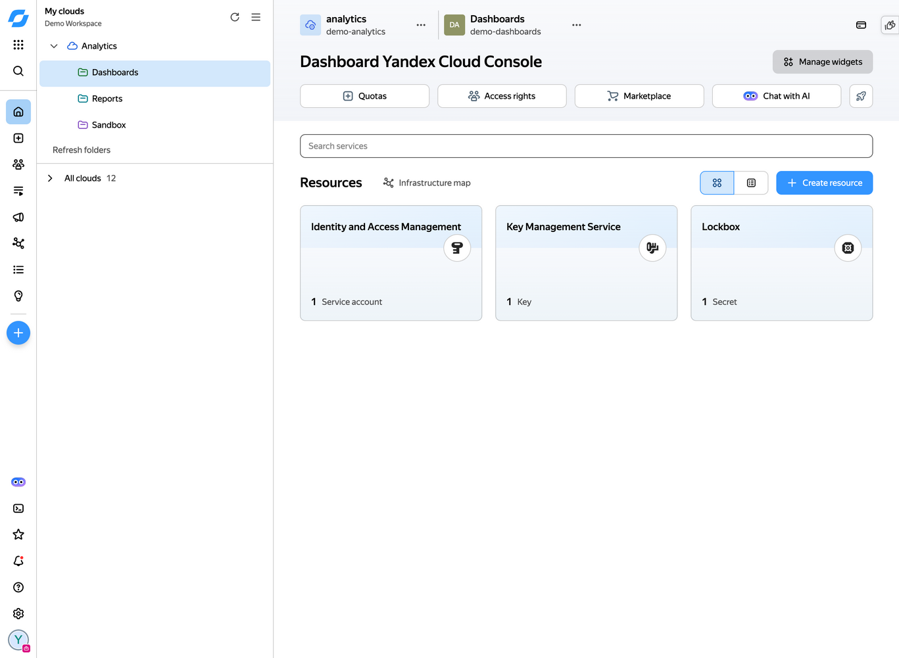
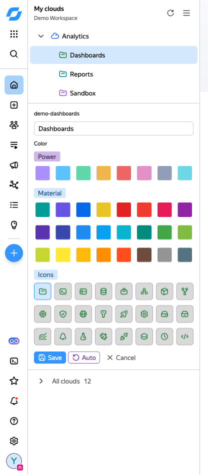
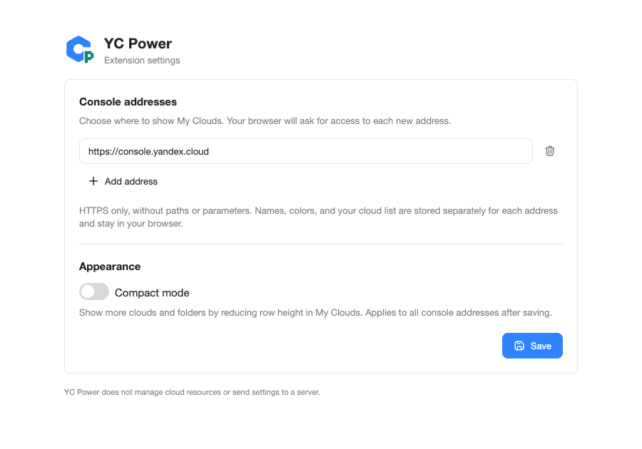

<div align="center">
  
  <h1>YC Power</h1>
  <p>A focused cloud navigation panel for the Yandex Cloud console</p>
</div>

YC Power brings your frequently used clouds and folders together in a compact sidebar for Firefox and Zen. Your selection and customizations stay in local browser storage, separately for each organization and console origin.



## Make the console yours

- Add or remove clouds from **My clouds**; refresh clouds and their folders together from the header
- Display the previous local catalog immediately while refreshing it in the background
- Open **All clouds** to use the original console tree and add clouds from it, or return to the native sidebar
- Get automatic short names and colors, then override either with your own label and one of 32 preset colors in the Power and Material palettes
- Choose one of 24 Gravity UI icons for each folder; clouds keep their original icon
- Use the header button to show all clouds in the new style when an organization has fewer than 10 clouds
- Remember expanded clouds and automatically reveal the cloud you navigate to
- Keep selected clouds, labels, colors, and sidebar width separate for every organization
- Use compact Gravity UI actions and drag the sidebar edge to adjust its width, with an automatic minimum that keeps the actions on one line and a 440 px maximum
- Start with the current cloud automatically selected when it can be identified on first use
- Enable compact mode in extension settings to reduce row height and spacing
- Follow the console's Gravity theme and font, including light and dark themes
- Use Russian or English according to the console language; extension settings follow the browser language, with English as the fallback

| Customize a cloud or folder | Choose console origins |
| --- | --- |
|  |  |

Screenshots use the real console interface with demo cloud and folder names. The console layout and branding are unchanged.

## Browser support and access

YC Power supports desktop Firefox 140 and later and compatible versions of Zen. Android has not been tested.

By default the extension runs only on `https://console.yandex.cloud`. Use the extension icon to add other HTTPS console origins. The browser requests permission for each added origin. Enter an origin without a path, port, or parameters; an empty list disables the extension on all consoles. See [PRIVACY.md](PRIVACY.md) for details about data and permissions.

## Install

Download the signed XPI from [Releases](https://github.com/64mb/yc-power/releases/latest). In Firefox or Zen, open `about:addons`, choose "Install Add-on From File" from the gear menu, and select the XPI. Updates keep the same extension ID and preserve your settings.

## Build and test

Node.js and Python 3 are required. React and Gravity UI are bundled locally; no third-party Python packages are required.

```sh
npm ci
npm run build
npm test
python3 tests/firefox-ui-smoke.py
```

The build creates `build/yc-power-firefox.xpi`. It contains the extension and `THIRD_PARTY_NOTICES.txt` for bundled dependencies.

## Install for development

Open `about:debugging#/runtime/this-firefox` in Firefox or Zen, choose "Load Temporary Add-on", and select the XPI or `manifest.json`. A temporary add-on is removed when the browser restarts.
